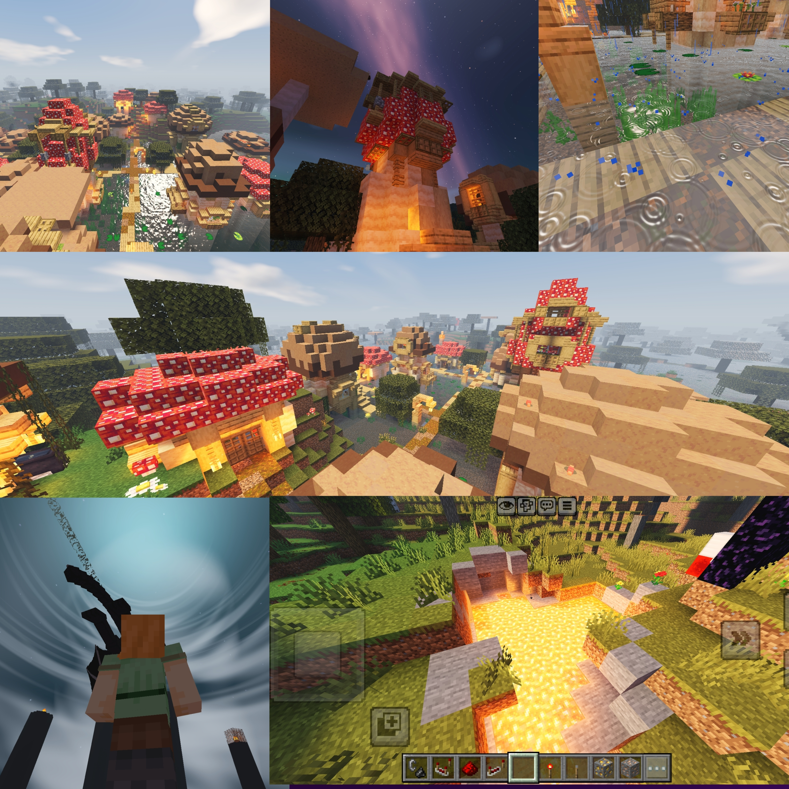

# Naresh Render Dragon Shader

A shader pack for Minecraft Bedrock (RenderDragon) by Naresh with soft clouds, a big moon with glow, northern lights, cinematic tone mapping, world light with block shadows, water and block reflections.

This repository has its own layout and its own build tool (`naresh.py`).

## Screenshots



## What you need

- Python 3.11 or newer
- lazurite: `pip install -r requirements.txt`

The shader compiler (`shaderc`) and required game materials are downloaded automatically by `setup`.

You do not need to find or download the material `.bin` files manually.

## Build

```bash
cd ~/Desktop/naresh-renderdragon

pkg update -y
pkg install python git -y

python -m pip install --upgrade pip
pip install -r requirements.txt

python naresh.py setup
python naresh.py check
python naresh.py pack -p android
```

`setup` is only needed once.

`-p` can be `android`, `ios`, `windows` or `all`. The pack is written to `build/`.

`python naresh.py build` only compiles the materials.

## Subpacks

The pack has three quality subpacks, set in `pack.toml`.

| Subpack | What it does |
|---|---|
| Low | no water, glass and block reflections |
| Medium | the main pack |
| Ultra | full steps for fog and sky |

The build adds a `subpacks` folder to the mcpack and the list to `manifest.json`.

## Settings

Open `lib/settings.h`, change a value and build again.

The main ones:

| Setting | What it does |
|---|---|
| `NRS_TM_SOFT`, `NRS_TM_FILMIC`, `NRS_TM_ACES`, `NRS_TM_REINHARD` | how much of each tone curve goes into the mix (the soft curve is the main look) |
| `NRS_TM_CONTRAST`, `NRS_TM_SATURATION`, `NRS_TM_WARMTH` | grade of the result |
| `NRS_SUN_POWER`, `NRS_AMBIENT_POWER`, `NRS_MOON_POWER`, `NRS_TORCH_POWER` | strength of sun, sky light, moon light and torch light |
| `NRS_SUN_TINT`, `NRS_AMBIENT_TINT`, `NRS_SHADOW_TINT` | colour of the sun light, the sky light and the shadows |
| `NRS_SHADOW_SOFTNESS`, `NRS_AO_POWER` | edge of block shadows, corner darkness |
| `NRS_CLOUDS`, `NRS_CLOUD_COVER`, `NRS_CLOUD_SCALE`, `NRS_CIRRUS` | clouds on/off, amount, size, thin high clouds |
| `NRS_MOON_SIZE`, `NRS_MOON_GLOW` | size of the moon and the glow around it |
| `NRS_NIGHT_SKY`, `NRS_NIGHT_SKY_POWER`, `NRS_STARS` | purple night sky band and own stars (only at night) |
| `NRS_AURORA`, `NRS_AURORA_POWER` | northern lights at night |
| `NRS_RAIN_SUN_HIDE`, `NRS_RAIN_DARKEN` | in rain: how much the sun and moon fade, how dark the world light gets |
| `NRS_RAIN_WET`, `NRS_RAIN_RIPPLE`, `NRS_RAIN_RIPPLE_SCALE`, `NRS_RAIN_RIPPLE_SPEED` | wet ground that reflects the sky, rain drop rings on ground and water |
| `NRS_RAIN_FOG_CLEAR`, `NRS_RAIN_FOG_WET` | how the pack tells rain from clear weather (fog start of the game) |
| `NRS_RAIN_TEST` | 1 forces rain all the time, to check the look |
| `NRS_RAIN_DEBUG` | 1 paints the world with the fog values of the game, to tune the two rain values above |
| `NRS_FOG_RANGE` | distance of the fog |
| `NRS_WATER_TYPE`, `NRS_WATER_CLARITY` | flat or wavy water, how clear it is |
| `NRS_WATER_WAVE_STRENGTH`, `NRS_WATER_WAVE_SPEED` | height and speed of the moving water waves |

## Metal and glossy blocks

A block reflects the sky and clouds when its texture has the material flags in the alpha channel.

`tools/metal_alpha.py` writes them:

```bash
python tools/metal_alpha.py in.png out.png iron
```

`gold`, `silver`, `copper`, `iron` or `gloss` can be used as the material type.

## Folders

| Folder | Content |
|---|---|
| `shaders/` | one folder per material, `project.json` is the lazurite project |
| `lib/` | shader code shared by all materials |
| `include/` | headers that the compiler needs |
| `assets/` | pack icon and biome colours |
| `vanilla/` | game materials (filled by setup) |
| `tools/` | shaderc and helper scripts |
| `docs/` | notes |

See `docs/how-it-works.md` for how the build works.

## License

MIT License

Copyright © 2026 Naresh

The shader code in `lib/` and `shaders/` was written new for this project.

The visual ideas and overall look were inspired by studying different shader packs but no code was copied from them.

Everyone can use this source under the MIT License and make their own variant.

See `LICENSE` and `NOTICE.md` for the full license and project notice.
